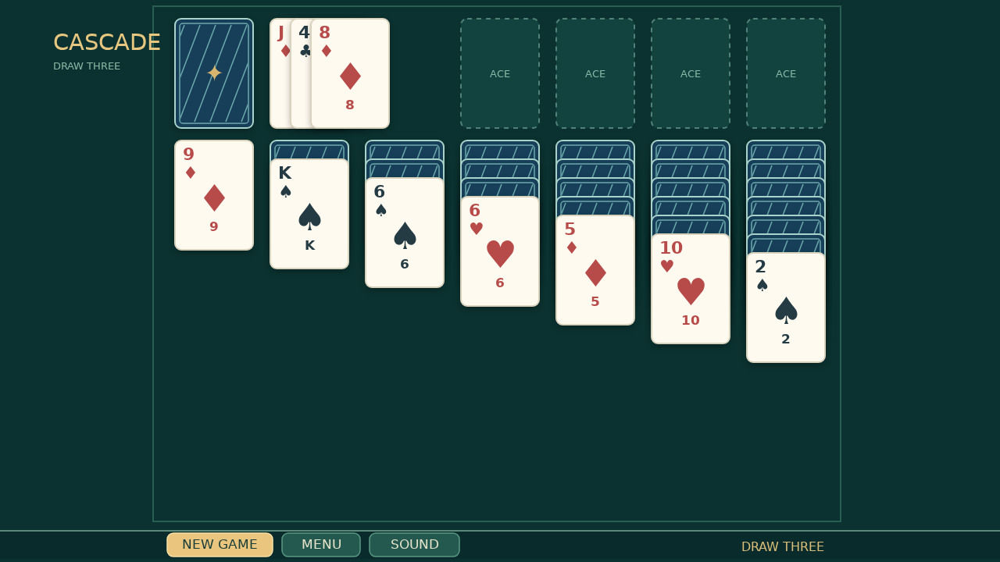

# Cascade

Cascade is a quiet game of Draw Three Klondike on deep green felt. Turn the stock three cards at a time, watch the waste fan open, and look for a way to uncover each buried card.

Build the four foundations from Ace to King. Columns build downward in alternating colors; an empty space waits for a King. Drag a single card or a whole run, or double-click a card to send it home.

When the final card reaches a foundation, the table comes alive. Cards launch in sequence, bounce along the floor, and leave a growing trail until the felt disappears beneath them.

